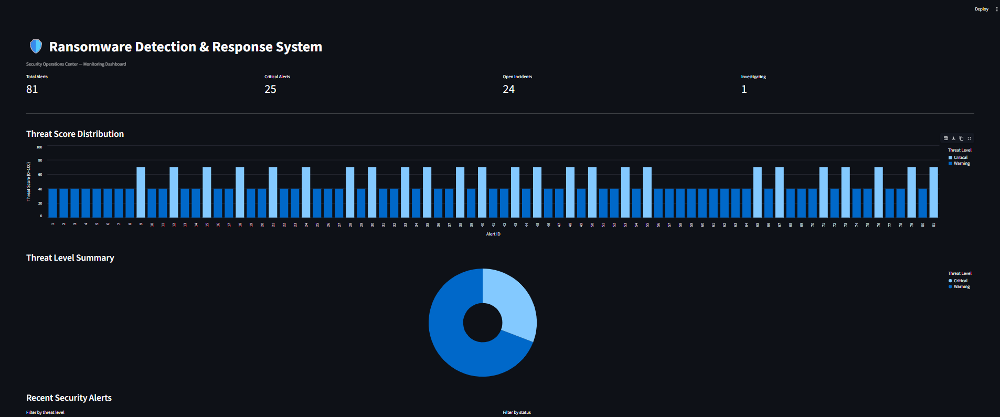
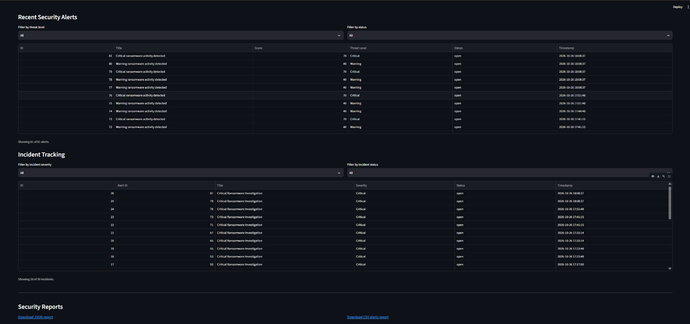
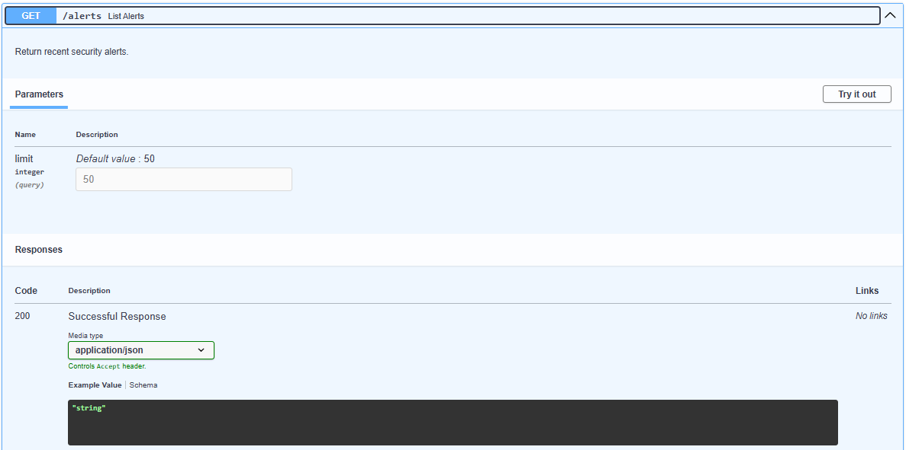
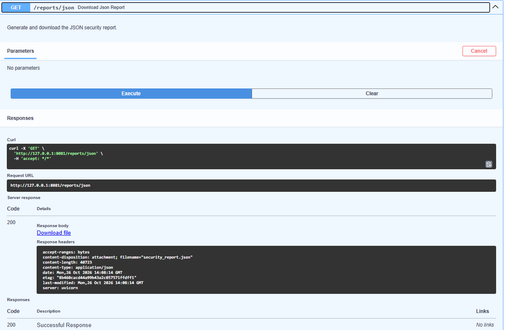
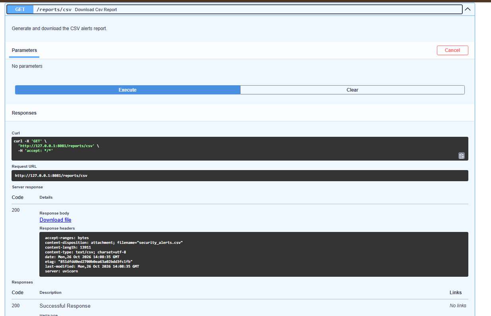

# Ransomware Detection & Response System (RDRS)

A defensive cybersecurity project that detects ransomware-like file activity using rule-based threat scoring, records alerts and incidents, and provides a monitoring dashboard, REST API, and security reports.

## Project Overview

The Ransomware Detection & Response System (RDRS) monitors file activity and evaluates suspicious behavior using configurable detection thresholds. It calculates a threat score, generates security alerts, creates incidents for Critical detections, and stores security information in an SQLite database.

The project is designed for educational and defensive security testing in a controlled sandbox. It does not require real ransomware.

## Dashboard Preview

The dashboard displays alert statistics, threat-score distribution, threat-level summaries, recent alerts, incident tracking, and report download options.



## Screenshots

### 1. Security Alerts, Incident Tracking, and Reports



### 2. Alert API

The FastAPI endpoint returns security alert records, including threat scores, severity levels, status, and timestamps.



### 3. JSON Security Report

The JSON report endpoint generates a downloadable security report.



### 4. CSV Security Report

The CSV report endpoint generates a downloadable alerts report.



## Features

- File-system event monitoring using Watchdog.
- Detection of rapid file modifications and mass renaming.
- File entropy analysis for potentially suspicious changes.
- Process information collection and CPU-usage checks.
- Rule-based threat scoring from 0 to 100.
- Warning and Critical security alerts.
- Incident creation for Critical detections.
- Incident status management.
- SQLite database integration using SQLAlchemy.
- FastAPI REST API with interactive documentation.
- Streamlit monitoring dashboard.
- JSON and CSV report generation.
- Automated testing using Pytest.
- Five-minute duplicate-alert suppression based on matching recent alert fingerprints.

## Technology Stack

| Technology | Purpose                         |
| ---------- | ------------------------------- |
| Python     | Application and detection logic |
| FastAPI    | REST API                        |
| Streamlit  | Monitoring dashboard            |
| SQLite     | Data storage                    |
| SQLAlchemy | Database interaction            |
| Watchdog   | File-system monitoring          |
| Pytest     | Automated testing               |
| PowerShell | Windows development environment |

## Detection Logic

The detection engine assigns weights to suspicious activity indicators.

| Indicator          | Weight |
| ------------------ | -----: |
| Rapid file changes |    +40 |
| Mass file renames  |    +30 |
| High file entropy  |    +25 |
| High CPU usage     |    +15 |
| Unknown process    |    +10 |

The combined threat score is capped at 100.

### Threat Levels

| Threat score | Level    |
| ------------ | -------- |
| Below 40     | Normal   |
| 40–69        | Warning  |
| 70–100       | Critical |

Critical detections can create investigation incidents.

**Implementation note:** Unknown processes are evaluated, but the current combined scoring logic does not add the unknown-process weight to the final score.

### Duplicate-Alert Suppression

The detection engine checks recent database alerts for a matching fingerprint within a five-minute window to reduce repeated alerts.

This is a best-effort safeguard. It is not guaranteed to prevent duplicates created simultaneously by multiple processes.

## Project Structure

```text
ransomware-detection-response-system/
├── app/
│   ├── api/
│   ├── core/
│   ├── database/
│   ├── detectors/
│   ├── dashboard/
│   ├── reports/
│   └── main.py
├── tests/
│   ├── conftest.py
│   ├── test_api.py
│   ├── test_detection_engine.py
│   └── test_reports.py
├── data/
│   └── sandbox/
├── logs/
├── screenshots/
│   ├── dashboard.png
│   ├── alerts-incidents-reports.png
│   ├── alerts-api.png
│   ├── reports-json.png
│   └── reports-csv.png
├── config.yaml
├── requirements.txt
└── README.md
```

## Requirements

- Python 3.12 or newer
- Git
- Windows PowerShell or a compatible terminal

## Installation

Clone the repository:

```powershell
git clone https://github.com/sairam3-dev/ransomware-detection-response-system.git
cd ransomware-detection-response-system
```

Create and activate a virtual environment:

```powershell
python -m venv .venv
.\.venv\Scripts\Activate.ps1
```

Install dependencies:

```powershell
python -m pip install -r requirements.txt
```

Before starting the file monitor, review `config.yaml` and ensure that monitored paths point to a dedicated test sandbox.

## Running the Application

Run each component in a separate terminal from the project root. Activate the virtual environment in each terminal.

### 1. Start the API

```powershell
python -m app.main
```

Open the interactive API documentation:

http://127.0.0.1:8081/docs

### 2. Start the File Monitor

```powershell
python -m app.detectors.file_monitor
```

Use only harmless test files in the configured sandbox.

### 3. Start the Dashboard

```powershell
python -m streamlit run app/dashboard/dashboard.py
```

Open the dashboard:

http://localhost:8501

## API Endpoints

| Method | Endpoint                          | Description                         |
| ------ | --------------------------------- | ----------------------------------- |
| GET    | `/health`                         | Check API health                    |
| GET    | `/alerts`                         | Retrieve recent security alerts     |
| GET    | `/incidents`                      | Retrieve recent security incidents  |
| PATCH  | `/incidents/{incident_id}/status` | Update an incident status           |
| GET    | `/reports/json`                   | Generate and download a JSON report |
| GET    | `/reports/csv`                    | Generate and download a CSV report  |

Use the interactive API documentation at `/docs` to test endpoints.

## Reports

The system supports two report formats:

- **JSON:** Security report containing a generation timestamp, alerts, and incidents.
- **CSV:** Tabular alerts report suitable for reviewing or processing in spreadsheet software.

The report endpoints return downloadable files.

## Testing

Run the automated test suite:

```powershell
python -m pytest -q
```

**Latest verified result:** 22 passed, 0 failed, with 3 deprecation warnings.

The tests cover API behavior, detection-engine logic, duplicate alert and incident behavior, and report generation. Test database isolation is configured separately from the live application database.

## Safety and Limitations

- Run monitoring only against a dedicated sandbox or other authorized test location.
- Do not use real ransomware or test against personal or production files.
- Detection is rule-based and may produce false positives or miss some attack patterns.
- Five-minute duplicate suppression is best-effort and is not concurrency-proof.
- Unknown-process scoring is not currently included in the combined threat score.
- The application currently reports deprecation warnings from the API framework and test-client dependencies.

## Project Status

The core detection engine, database integration, API, dashboard, reporting endpoints, and automated tests have been implemented and verified in the local development environment.

Potential future improvements include stronger cross-process duplicate suppression, additional integration tests, test coverage measurement, and containerized deployment.

## Repository

GitHub: https://github.com/sairam3-dev/ransomware-detection-response-system

## Disclaimer

This project is developed for educational and defensive cybersecurity purposes only.
